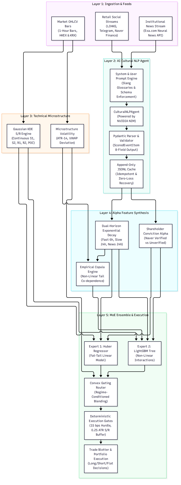
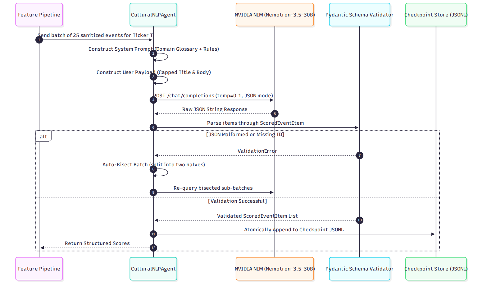
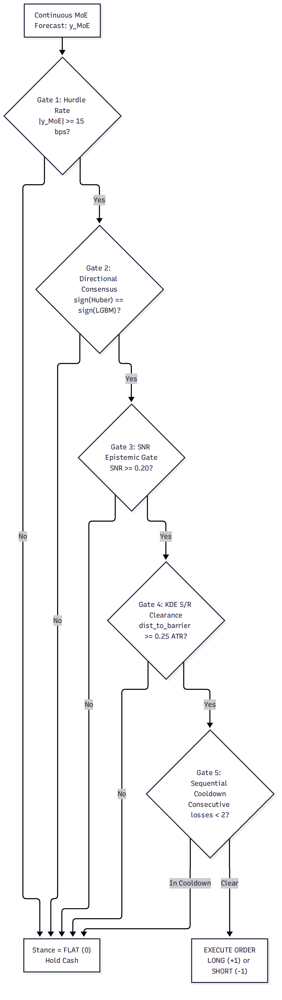

# Asian Equities Sentiment Alpha Trading System
## Systematic Intraday Alpha Strategy Across HKEX and KRX Technology Equities

---

## Executive Summary

This repository houses the end-to-end implementation of an autonomous **AI Cultural NLP Agent and Quantitative Alpha Trading System** operating across two major East Asian equity markets: **Hong Kong (HKEX - Hang Seng Tech)** and **South Korea (KRX - KOSPI Tech)**.

The framework processes raw Asian retail discussion streams (LIHKG, Naver Finance, Telegram) and institutional news (Exa.com Neural News API), extracts structured sentiment indicators through a dedicated foundation model agent powered by **NVIDIA NIM**, and synthesizes those signals with technical market microstructure features. A learned **Mixture-of-Experts (MoE)** machine learning ensemble combines a robust linear Huber Regressor with a constrained LightGBM decision tree, executing risk-managed 1-hour trade decisions filtered through five deterministic execution gates.

Detailed system architecture and methodology documentation is available in [docs/system_architecture_report.md](file:///mnt/new_volume/stacks/Machine_learning_projects/asian-equities-sentiment-alpha/docs/system_architecture_report.md).

---

## System Architecture: The 5 Sequential Layers

The platform is engineered as a modular, 5-stage causal processing pipeline with strict point-in-time temporal boundaries:

1. **Layer 1: Ingestion & Market Feeds:** Ingests live 1-hour OHLCV market bars for 10 target assets, continuous retail social feeds from Hong Kong and South Korea, and verified institutional news wires.
2. **Layer 2: AI Cultural NLP Agent (`CulturalNLPAgent`):** Interfaces with **NVIDIA NIM** running `nvidia/nemotron-3.5-lightning-30b-a3b` with domain-specific Cantonese and Korean financial glossaries, sarcasm reversal logic, token-bucket rate limiting (25 RPM), recursive auto-bisection recovery (0% dropped records), and Pydantic schema validation.
3. **Layer 3: Technical Microstructure Engine (`quant_technical`):** Deterministic mathematical module executing rolling 72-hour Gaussian Kernel Density Estimation (KDE) to discover continuous Support ($S_1, S_2$) and Resistance ($R_1, R_2$) price barriers alongside 14-period Average True Range (ATR) and VWAP metrics.
4. **Layer 4: Alpha Feature Synthesis Pipeline (`alpha_factors`):** Generates dual-horizon exponential decay features ($\tau_{1/2} = 6\text{h}$ fast retail, $\tau_{1/2} = 24\text{h}$ slow retail, $\tau_{1/2} = 24\text{h}$ news), calculates Naver verified-shareholder conviction spreads, and constructs Empirical Copula tail interaction factors (`copula_div_vol`, `copula_div_trend`).
5. **Layer 5: Mixture-of-Experts & Execution Gating (`moe_gating` & `backtest`):** Dynamically routes between a robust Huber Regressor and a shallow LightGBM tree using a state-conditioned Ridge Logistic Gating network, filtering trade orders through five deterministic risk gates.



---

## Target Asset Universe & Verified Data Ingestion

### Target Asset Universe (10 Technology Equities)

The system trades a locked universe of 10 large-cap technology equities evenly balanced across HKEX and KRX:

| Exchange | Ticker Symbol | Local Name | Company Name | Primary Sector & Trading Role | Key Search Terms & Cashtags |
| :--- | :--- | :--- | :--- | :--- | :--- |
| **HKEX** | `0700.HK` | 騰訊控股 | Tencent Holdings | Mega-Cap Tech / Gaming & Cloud Anchor | `$0700`, `騰訊`, `腾讯`, `0700` |
| **HKEX** | `9988.HK` | 阿里巴巴 | Alibaba Group | E-Commerce, Ant Group & Cloud AI | `$9988`, `阿里巴巴`, `阿里`, `9988` |
| **HKEX** | `1810.HK` | 小米集團 | Xiaomi Corporation | Consumer Hardware, Smart Devices & EV | `$1810`, `小米`, `小米集團`, `1810` |
| **HKEX** | `0981.HK` | 中芯國際 | SMIC | Semiconductor Fabrication & Foundries | `$0981`, `中芯`, `中芯國際`, `0981` |
| **HKEX** | `1211.HK` | 比亞迪股份 | BYD Company | Electric Vehicles & Battery Manufacturing | `$1211`, `比亞迪`, `比亚迪`, `1211` |
| **KRX** | `005930.KS` | 삼성전자 | Samsung Electronics | KOSPI Benchmark / Memory Chips & Tech | `$005930`, `삼성전자`, `삼전`, `005930` |
| **KRX** | `000660.KS` | SK하이닉스 | SK Hynix | AI High-Bandwidth Memory (HBM) & DRAM | `$000660`, `SK하이닉스`, `하이닉스`, `000660` |
| **KRX** | `035720.KS` | 카카오 | Kakao Corp. | Social Super-App & Domestic Platforms | `$035720`, `카카오`, `035720` |
| **KRX** | `005380.KS` | 현대자동차 | Hyundai Motor | Global Automotive & Next-Gen Mobility | `$005380`, `현대차`, `현대자동차`, `005380` |
| **KRX** | `373220.KS` | LG에너지솔루션 | LG Energy Solution | Global Tier-1 EV Battery Cell Manufacturer | `$373220`, `LG에너지솔루션`, `LG엔솔`, `373220` |

### Ingestion Feeds & Exact Apify Actors

| Source Name | Exchange | Ingestion Engine / Exact Apify Actor ID | Target Platform / Endpoint | Harvest Mode & Parameters |
| :--- | :---: | :--- | :--- | :--- |
| **LIHKG** | HKEX | `claude_code_reviewer/lihkg-scraper-en` | Category 15 (財經台 — Finance Board) | 2-step budget-protected harvest (capped at $1.00 USD), keyword token search (`cat_ids: ["15"]`). |
| **Telegram (HKEX)** | HKEX | `apify/cheerio-scraper` | 6 Live-Verified Hong Kong Channels | Light Cheerio HTML scraper: keyword mode (`max_pages: 25`) and full-feed desk mode (`max_pages: 40`). |
| **Naver Finance** | KRX | `apify/cheerio-scraper` | 종목토론방 (Stock Discussion Room) | Mobile front REST API scraper (`pageSize=100`, max 200 pages); extracts verified shareholder flag (`holder_verified = true`). |
| **Telegram (KRX)** | KRX | `apify/cheerio-scraper` | 6 Live-Verified South Korean Channels | Light Cheerio HTML scraper: keyword mode (`max_pages: 25`) and full-feed desk mode (`max_pages: 40`). |
| **Institutional News** | Both | **Exa.com Neural News API** *(Direct API)* | Tier-1 Verified Financial Press | Semantic neural embeddings querying *Bloomberg, Reuters, Yonhap, Caixin, WSJ, Nikkei Asia*. |

#### Monitored Telegram Channels:
* **HKEX Channels:** `@Financial_Express` (37K), `@jin10data` (11.5K), `@golden_wind_news` (4.82K), `@zaobaosg` (46.4K), `@eco_cn` (12K), `@StockIntelligence` (2.29K).
* **KRX Channels:** `@faststocknews` (129K), `@realtime_stock_news` (36.9K), `@rassiro_channel` (5.91K), `@corevalue` (67K), `@hanaresearch` (25.2K), `@shinhanresearch` (21.8K).

### Data Timeline & Walk-Forward Partition

* **Total Dataset Window:** November 3, 2026 – November 20, 2026 (14 trading days, 905 total 1-hour bars, 895 non-null target bars).
* **Warmup / Burn-In Split:** Days 1–4 (Nov 3–6, 2026, 225 bars) — Initializes rolling KDE support/resistance curves, 14-period ATR, and exponential decay state.
* **In-Sample Training Split:** Days 5–7 (Nov 9–13, 2026, 540 valid bars) — Fits the Huber Regressor, LightGBM, and feature scalers.
* **Validation Embargo:** Nov 16–17, 2026 (2 trading days) — Purged buffer preventing 24h rolling decay leakage; used for 5-fold cross-validation of the MoE gating router.
* **Out-of-Sample Holdout Test:** Days 8–10 (Nov 18–20, 2026, 180 hourly bars: 100 HKEX, 80 KRX) — Strictly unmutated walk-forward evaluation producing 79 active trades and 101 flat decisions.

---

## AI Cultural NLP Agent Specifications

The cognitive backbone of the sentiment scoring pipeline is the `CulturalNLPAgent`, designed to process unstructured financial text into structured quantitative event scores.

### Foundation Model Inference (NVIDIA NIM)
* **Model ID:** `nvidia/nemotron-3.5-lightning-30b-a3b`
* **Inference Endpoint:** `https://integrate.api.nvidia.com/v1`
* **Inference Parameters:** `temperature: 0.1`, `max_tokens: 4096`, `chat_template_kwargs: {enable_thinking: false}`, `use_response_format_json: true`.
* **Rate Limiting:** TokenBucketRateLimiter enforcing 25 Requests-Per-Minute (RPM) with 5-worker thread concurrency.
* **Fault Tolerance:** 5-stage exponential backoff (`[3s, 6s, 12s, 24s, 48s]`) and recursive divide-and-conquer auto-bisection recovery guaranteeing zero dropped events.
* **Caching:** Append-only atomic JSONL caching (`data/processed/llm_scores_checkpoint.jsonl`) guaranteeing idempotent $O(1)$ checkpoint recovery.

### Pydantic Output Validation Schema

Every scored event returned by NVIDIA NIM is parsed and validated against the strict Pydantic model `ScoredEventItem`:

```python
class ScoredEventItem(BaseModel):
    event_id: str
    sentiment_score: float = Field(ge=-1.0, le=1.0)
    direction: Literal["bullish", "bearish", "neutral"]
    confidence: float = Field(ge=0.0, le=1.0)
    is_sarcastic: bool = False
    hype_score: float = Field(ge=0.0, le=1.0)
    catalyst_type: Literal[
        "earnings", "guidance", "analyst_rating", "macro_policy",
        "product_tech", "flow_squeeze", "retail_rumor", "other"
    ]
    price_target_mentioned: float | None = None
    english_summary: str
```



---

## Technical Microstructure & Alpha Feature Engineering

1. **Non-Parametric Gaussian KDE Support & Resistance:** Continuous probability density estimation over rolling 72-hour windows:
   $$\hat{f}(y) = \frac{1}{N h} \sum_{i=1}^N \frac{1}{\sqrt{2\pi}} \exp\left( -\frac{(y - P_i)^2}{2 h^2} \right)$$
   Identifies local density maxima for Support floors ($S_1, S_2$) and Resistance ceilings ($R_1, R_2$) alongside Point of Control (POC). Scale-invariant barrier distances are normalized by 14-period ATR.
2. **Dual-Horizon Exponential Decay:**
   $$w_i(t) = w_{0, i} \cdot 2^{-\frac{t - t_i}{\tau_{1/2}}}$$
   Synthesizes three decay horizons using initial base weight $w_{0, i}$ (`base_weight`): Fast Retail ($\tau_{1/2} = 6.0\text{h}$), Slow Retail ($\tau_{1/2} = 24.0\text{h}$), and Institutional News ($\tau_{1/2} = 24.0\text{h}$).
3. **Shareholder Conviction Spread (KRX):**
   $$\Delta_{\text{verified}} = \text{Sentiment}_{\text{verified}} - \text{Sentiment}_{\text{unverified}}$$
   Isolates brokerage-verified shareholders on Naver Finance to measure smart-money positioning against unverified retail noise.
4. **Sentiment Divergence & Empirical Copula Alpha:**
   $$\text{Divergence}_{24\text{h}} = \text{News}_{24\text{h}} - \text{Retail}_{24\text{h}}$$
   Computes empirical probability integral transforms $u_{\text{div}} = \hat{F}_{\text{div}}(\text{Divergence})$ and $u_{\text{vol}} = \hat{F}_{\text{vol}}(\text{Realized Vol}_{12\text{h}})$ to generate joint tail interaction factors (`copula_div_vol`, `copula_div_trend`).

---

## Quantitative ML Models & Learned MoE Ensemble

### Target Variable Formulation

To eliminate cross-sectional volatility distortion across high-beta and low-beta equities, the 1-hour forward log return $r_{1h, t+1} = \ln(\text{Close}_{t+1} / \text{Close}_t)$ is normalized by local realized ATR volatility:

$$\sigma_{\text{vol}, t} = \max(\text{ATR}_{\%, 14}, 0.002)$$

$$y_t = \text{clip}\left( \frac{r_{1h, t+1}}{\sigma_{\text{vol}, t}}, -4.0, +4.0 \right)$$

where $\sigma_{\text{vol}, t}$ denotes the local volatility scale factor (`vol_scale` in code, floored at 20 bps).

### 38-Feature Matrix Specification
* **Group A (13 Features): Price, Volume & Microstructure Clock:** `log_ret_1h`, `log_ret_3h`, `log_ret_6h`, `realized_vol_12h`, `atr_pct`, `rsi_14`, `price_vs_vwap_pct`, `volume_zscore_24h`, `bar_range_pct`, `close_pos_in_bar`, `is_session_close_bar`, `bar_duration_min_is_30`, `is_hkex`.
* **Group B (5 Features): Deterministic KDE S/R Barriers:** `dist_to_support_1_atr`, `dist_to_resistance_1_atr`, `sr_risk_reward_ratio`, `dist_to_poc_atr`, `in_value_area`.
* **Group C (20 Features): Sentiment Alpha & Epistemic Signals:** `retail_sent_6h`, `retail_sent_24h`, `retail_sent_momentum`, `news_sent_24h`, `divergence_retail_vs_news_24h`, `divergence_retail_vs_news_fast`, `mention_velocity_zscore_24h`, `engagement_velocity_zscore_24h`, `mention_acceleration`, `sarcasm_rate_24h`, `hype_intensity_24h`, `sentiment_dispersion_24h`, `net_crowd_approval_24h`, `hours_since_last_social`, `hours_since_last_news`, `holder_vs_nonholder_spread_24h`, `verified_holder_share_24h`, `has_verified_holder_signal`, `copula_div_trend`, `copula_div_vol`.

### Base Models & Gating Optimization
1. **Expert 1: Robust Huber Regressor:**
   $$\min_w \sum_{i=1}^N \rho_\epsilon(y_i - x_i^T w) + \alpha \|w\|_2^2$$
   Transition parameter $\epsilon=1.35$ (providing 95% Gaussian asymptotic efficiency while capping outlier derivative penalties) and $L_2$ ridge regularization $\alpha=10.0$ (`max_iter=500`), preceded by `RobustScaler`.
2. **Expert 2: Constrained Shallow LightGBM Regressor:**
   Huber loss objective ($\alpha=1.35$), `max_depth: 2`, `num_leaves: 4`, `min_child_samples: 15`, `learning_rate: 0.03`, `n_estimators: 60`, `colsample_bytree: 0.7`, `subsample: 0.8`, `reg_alpha: 1.0`, and `reg_lambda: 10.0`.
3. **Learned Ridge Logistic Gating Network:**
   Blends the base models dynamically:
   $$\hat{y}_{\text{MoE}}(x) = (1 - \pi(s)) \cdot \hat{y}_{\text{Huber}}(x) + \pi(s) \cdot \hat{y}_{\text{LGBM}}(x)$$
   Conditioned on market state vector $s = [\sigma_{12\text{h}}, \; \text{ATR}_{\%}, \; \Delta_{\text{sent}, 24\text{h}}]$ (mapped to feature columns `['realized_vol_12h', 'atr_pct', 'sentiment_dispersion_24h']`), initialized at empirical prior log-odds $b_0 = \ln(0.40/0.60) \approx -0.4055$ and trained via 5-fold cross-validation out-of-fold predictions.

---

## Deterministic Execution Gating & Risk Controls

Continuous forecasts from the MoE router are filtered through five discrete deterministic execution gates before generating orders:

$$\text{Stance} \in \{+1 \text{ (Long)}, \; -1 \text{ (Short)}, \; 0 \text{ (Flat / Safe Cash)}\}$$

1. **Hurdle Rate Gate ($15\text{ bps}$):** Forecast $|\hat{y}_{\text{MoE}}| \ge 15.0\text{ bps}$ ($0.0015$) to cover $3\times$ the $5\text{ bps}$ one-way transaction slippage.
2. **Directional Expert Consensus Gate:** Requires sign agreement: $\hat{y}_{\text{Huber}} > 0 \land \hat{y}_{\text{LGBM}} > 0$ for Long, and $< 0$ for Short.
3. **Epistemic Uncertainty & Scale-Invariant SNR Gate:**
   $$\sigma_{\text{epistemic}} = |\hat{y}_{\text{LGBM}} - \hat{y}_{\text{Huber}}|, \quad \sigma_{\text{aleatoric}} = \text{ATR}_{\%}$$
   $$\text{SE} = \sqrt{\sigma_{\text{epistemic}}^2 + (0.5 \cdot \sigma_{\text{aleatoric}})^2}, \quad \text{SNR} = \frac{\hat{y}_{\text{MoE}}}{\max(\text{SE}, 10^{-8})}$$
   Orders require $|\text{SNR}| \ge 0.20$. High model disagreement inflates SE, safely aborting execution.
4. **KDE Support/Resistance Barrier Clearance ($0.25\times\text{ATR}$ Buffer):**
   * Long orders blocked if normalized distance to resistance $< 0.25\times\text{ATR}$ (`dist_to_resistance_1_atr < 0.25`).
   * Short orders blocked if normalized distance to support $< 0.25\times\text{ATR}$ (`dist_to_support_1_atr < 0.25`).
5. **Sequential Loss Cooldown:** Two consecutive losses in the same directional stance activates a mandatory 2-bar trading halt.
6. **Volatility-Targeted Sizing:** Scales position sizes inversely with realized volatility to maintain portfolio-wide risk parity.



---

## Empirical Results: Out-of-Sample Validation

Backtested under strict walk-forward out-of-sample conditions across Days 8–10 (180 hourly bars across 10 equities, Nov 18–20, 2026), benchmarked against a **Tech-Only Baseline** (18 technical and KDE features without NLP signals):

| Performance Metric | Full MoE Alpha Strategy (38 Features) | Tech-Only Baseline (18 Features) | Value Added by AI Agent ($\Delta$) |
| :--- | :---: | :---: | :---: |
| **Spearman Rank IC** | **0.0930** | 0.0732 | **+0.0198** (Rank predictive boost) |
| **Out-of-Sample Net Return** | **+0.52% (+51.9 bps)** | +0.27% (+27.3 bps) | **+24.5 bps** (Net alpha spread) |
| **Annualized Sharpe Ratio** | **14.42** | 7.09 | **+7.33** (Risk-adjusted return expansion) |
| **Profit Factor** | **2.17** | 1.49 | **+0.68** |
| **Maximum Drawdown** | **-0.13%** | -0.18% | **+0.05%** (Drawdown reduction) |
| **Active Trade Executions** | 79 bars | 75 bars | Higher selectivity via sentiment gates |

### Cross-Exchange Performance Disparity
* **HKEX Portfolio (Hang Seng Tech):** Delivered **+0.92% net return** (Sharpe 17.06, Max Drawdown -0.19%). Chinese and Cantonese retail communities demonstrated high predictive alignment with institutional momentum.
* **KRX Portfolio (KOSPI Tech):** Delivered **+0.12% net return** (Sharpe 3.12, Max Drawdown -0.34%). Korean retail discussions showed higher noise, stabilized by the verified-shareholder conviction spread.

---

## Repository Structure

```
asian-equities-sentiment-alpha/
|-- config/
|   |-- phase2.yaml              # NLP & NVIDIA NIM inference configurations
|   |-- phase3.yaml              # Machine learning, MoE gating & backtest configurations
|   |-- sources.yaml             # Scraper actor IDs, target channels, and budgets
|   `-- universe.yaml            # Locked 10-stock universe and trading schedules
|-- data/
|   |-- processed/
|   |   |-- bars_1h.parquet      # 905 aligned 1-hour OHLCV market bars
|   |   |-- features_1h.parquet  # 38-feature engineered time series matrix
|   |   |-- llm_scores_checkpoint.jsonl  # Append-only scored event store
|   |   `-- live_snapshot.parquet# Snapshot features for real-time predictions
|   `-- raw/                     # Ingested social media and news JSON records
|-- docs/
|   |-- images/                  # High-DPI architecture flowcharts and diagrams
|   `-- system_architecture_report.md # Canonical technical documentation whitepaper
|-- reports/
|   `-- cwt_visual_report.html   # Standalone interactive dashboard & trade blotter
|-- scripts/
|   |-- cwt_visual_report_template.html # Visual dashboard template
|   `-- generate_cwt_visual_report.py   # Report generation script
|-- src/
|   |-- features/
|   |   |-- alpha_factors.py     # Exponential decay, copulas, and factor synthesis
|   |   |-- llm_client.py        # NVIDIA NIM client, rate limiter, and auto-bisection
|   |   `-- schemas.py           # Pydantic schemas and feature definitions
|   |-- ingest/
|   |   |-- prices.py            # OHLCV price ingestion and session alignment
|   |   `-- social.py            # Apify scrapers for LIHKG, Naver, and Telegram
|   `-- models/
|       |-- backtest.py          # Vectorized walk-forward engine and execution gates
|       |-- dataset.py           # Zero-lookahead train/validation/test splitters
|       |-- ensemble.py          # Learned MoE ensemble and logistic gating router
|       |-- run.py               # Phase 3 training and backtest execution runner
|       `-- schemas.py           # Hyperparameter schemas and dataclasses
|-- tests/
|   `-- test_phase3_unit.py      # Comprehensive 11-stage unit verification suite
|-- pyproject.toml               # Package build configuration
|-- README.md                    # Primary repository overview
`-- requirements.txt             # Project Python dependencies
```

---

## Installation & Getting Started

### 1. Prerequisites
* Python 3.10 or higher
* Valid API credentials:
  * `NVIDIA_API_KEY` (NVIDIA NIM access)
  * `APIFY_TOKEN` (LIHKG, Telegram, and Naver Finance scrapers)
  * `EXA_API_KEY` (Institutional news neural search)

### 2. Environment Setup
```bash
# Clone the repository
git clone https://github.com/your-username/asian-equities-sentiment-alpha.git
cd asian-equities-sentiment-alpha

# Create and activate a virtual environment
python3 -m venv .venv
source .venv/bin/activate

# Install required dependencies
pip install -r requirements.txt
```

### 3. Environment Variables
Create a `.env` file in the project root:
```bash
NVIDIA_API_KEY=your_nvidia_api_key_here
APIFY_TOKEN=your_apify_token_here
EXA_API_KEY=your_exa_api_key_here
```

### 4. Running the Pipeline

#### Step 1: Feature Engineering & AI Sentiment Scoring
```bash
# Run NLP scoring and feature matrix generation
python3 -m src.features.run
```

#### Step 2: Model Training & Out-of-Sample Backtesting
```bash
# Train Huber + LightGBM models, fit MoE Gating Router, and execute walk-forward test
python3 -m src.models.run
```

#### Step 3: Interactive Visual Report Generation
```bash
# Generate the standalone HTML report and interactive trade blotter
python3 scripts/generate_cwt_visual_report.py
```
Open [reports/cwt_visual_report.html](file:///mnt/new_volume/stacks/Machine_learning_projects/asian-equities-sentiment-alpha/reports/cwt_visual_report.html) in any web browser to view the interactive trade blotter, cumulative returns, and factor distributions.

### 5. Running the Unit Test Suite
To verify zero-lookahead temporal integrity, feature matrix completeness, slippage deduction, and deterministic execution gating:
```bash
pytest -v tests/test_phase3_unit.py
```

---

## License

This project is licensed under the Apache 2.0 License.
