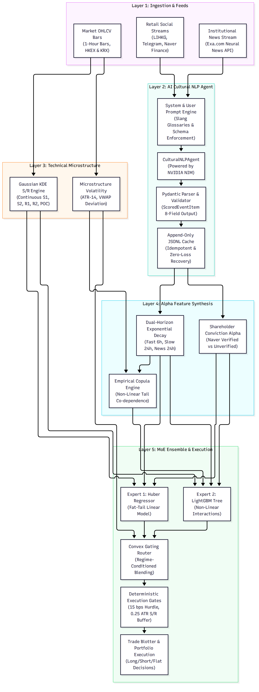
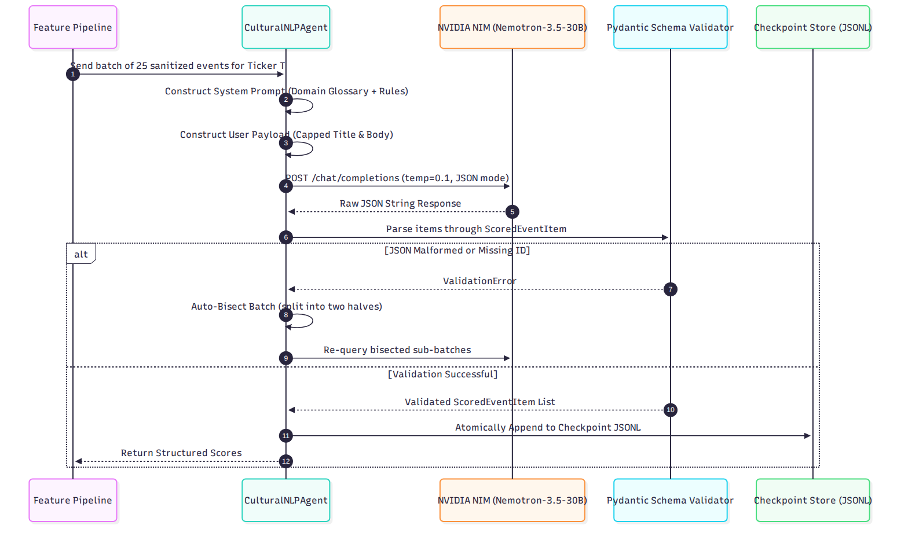
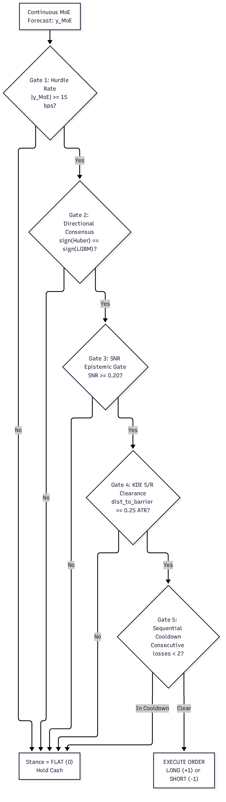

# AI Agent Architecture & Quantitative Sentiment Alpha
## Technical Whitepaper: Translating Multilingual East Asian Financial Media into Systematic Market Microstructure

---

## Executive Summary

This technical whitepaper explains the architecture, engineering design, and algorithmic mechanics of an autonomous **AI Agent and Quantitative Alpha Trading System** operating across two major Asian equity markets: **Hong Kong (HKEX - Hang Seng Tech)** and **South Korea (KRX - KOSPI Tech)**.

### What Problem Does This System Solve?
In Asian equity markets, retail trading communities (such as Hong Kong's LIHKG and South Korea's Naver Finance) drive significant intraday price momentum. However, traditional quantitative models struggle to process this data because:
1. **Intense Local Slang & Culture:** Messages are filled with colloquial Cantonese and Korean idioms that standard NLP tools misclassify.
2. **Prevalent Sarcasm & Reverse-Indicators:** Traders frequently post ironic praise when a stock is crashing, which naive models mistakenly treat as bullish.
3. **Information Divergence:** What retail traders believe on forums often directly clashes with verified institutional news, creating short-term mispricings.

This system bridges that gap by deploying a dedicated **AI Cultural NLP Agent (powered by NVIDIA NIM)** to interpret local nuances, converting those qualitative insights into mathematical features, and feeding them into an ensemble machine learning model to make systematic 1-hour trade decisions.

---

## 1. Quick Primer: Key Concepts & Terminology

For a reader reviewing this technical project for the first time, here is a quick reference guide to the core terms used throughout this document:

| Term / Acronym | Plain-English Definition |
| :--- | :--- |
| **HKEX & KRX** | The two target stock exchanges: **HKEX** (Hong Kong Stock Exchange: Tencent, Alibaba, Xiaomi, etc.) and **KRX** (Korea Exchange: Samsung Electronics, SK Hynix, Hyundai Motor, etc.). |
| **Hourly Trading Bar ($t_n$)** | The fundamental decision timeframe. The system re-evaluates the market every hour, generating a trade decision for the next 1-hour bar ($t_{n+1}$). |
| **Basis Points (bps)** | A standard financial unit of measurement: $1\text{ bps} = 0.01\% = 0.0001$. For example, a $+50\text{ bps}$ gain represents $+0.50\%$. |
| **Point-in-Time (Zero Lookahead)** | A strict quantitative integrity rule: when deciding at hour $n$, the model is strictly forbidden from seeing any data published after hour $n$. |
| **Sarcasm Inversion** | If an investor ironically praises a collapsing stock (e.g. *"Great job dumping on us, real masterclass"*), the AI flips the polarity to strongly negative (e.g. $-0.75$). |
| **Support ($S_1$) & Resistance ($R_1$)** | Key price boundaries discovered mathematically. **Support** is a price floor where buying interest concentrates; **Resistance** is a ceiling where selling pressure mounts. |
| **Trade Stance** | The three discrete execution decisions: **LONG (+1)** to buy, **SHORT (-1)** to sell short, or **FLAT (0)** to hold safe cash. |
| **Hurdle Rate ($15\text{ bps}$)** | A safety filter requiring a forecast to be at least $15\text{ bps}$ (covering $3\times$ the $5\text{ bps}$ execution slippage) before entering a trade. |

---

## 2. Core Architecture Overview: The 5 System Layers

The system is organized into a modular 5-stage sequential pipeline. Raw data flows in from the left, passes through the AI Agent and quantitative transformation engines, and terminates in risk-managed execution decisions on the right:

### Layer 1: Data Ingestion & Market Feeds
- **Social Media Scrapers:** Ingests live discussion streams from Hong Kong (LIHKG, Telegram) and South Korea (Naver Finance 종목토론방, Telegram).
- **Institutional News Stream:** Pulls verified corporate earnings, analyst rating revisions, and macro news via Exa.com Neural News API.
- **Hourly Price Bars:** Tracks 1-hour OHLCV (Open, High, Low, Close, Volume) data for all 10 target assets.

### Layer 2: The AI Cultural NLP Agent (`CulturalNLPAgent`)
- **Cognitive Engine:** Powered by **NVIDIA NIM** running `nvidia/nemotron-3.5-lightning-30b-a3b`.
- **Function:** Reads raw Asian social posts and news articles, applies Cantonese and Korean slang glossaries, detects sarcasm, scores retail hype/FOMO, extracts crowd price targets, and returns structured Pydantic-validated JSON.
- **Production Guardrails:** Token-bucket rate limiter ($25\text{ RPM}$), automatic batch bisection recovery for zero dropped data, and append-only local caching.

### Layer 3: Technical Microstructure Engine (`quant_technical`)
- **Deterministic Math Engine:** (Statistical code, distinct from the AI agent).
- **Function:** Fits a non-parametric Gaussian Kernel Density Estimation (KDE) curve across rolling 72-hour price distributions to mathematically detect Support floors ($S_1, S_2$) and Resistance ceilings ($R_1, R_2$) alongside 14-period Average True Range (ATR).

### Layer 4: Alpha Feature Synthesis Pipeline (`alpha_factors`)
- **Temporal Decay:** Applies exponential decay weighting ($\tau_{1/2} = 6\text{h}$ for fast social momentum, $\tau_{1/2} = 24\text{h}$ for persistent retail belief, and $\tau_{1/2} = 24\text{h}$ for institutional news).
- **Sentiment Divergence:** Calculates the spread between institutional news and retail sentiment ($\text{Divergence} = \text{News} - \text{Retail}$).
- **Empirical Copula:** Maps sentiment divergence against market volatility into rank-uniform space to capture non-linear joint tail risk.

### Layer 5: Mixture-of-Experts (MoE) & Execution Gating (`moe_gating` & `backtest`)
- **Predictive Ensemble:** Combines a robust linear model (**Huber Regressor**) and a non-linear gradient-boosted tree (**LightGBM**) via dynamic convex gating.
- **Deterministic Execution Gates:** Evaluates whether to execute (**LONG +1 / SHORT -1**) or stay **FLAT (0)** by verifying the $15\text{ bps}$ hurdle rate, expert consensus, and a $0.25\times\text{ATR}$ clearance buffer away from Support and Resistance barriers.



### 2.1 Target Asset Universe: Selected Stocks per Exchange

The system executes systematic trading across a locked, highly liquid universe of **10 flagship technology and high-growth equities** evenly split across the two target Asian exchanges (5 in Hong Kong, 5 in South Korea):

| Exchange | Ticker Symbol | Local Name | Company Name | Primary Sector & Market Profile | Key Retail Cashtags / Search Terms |
| :--- | :--- | :--- | :--- | :--- | :--- |
| **HKEX** | `0700.HK` | 騰訊控股 | Tencent Holdings | Mega-Cap Tech / Gaming & Cloud Anchor | `$0700`, `騰訊`, `腾讯`, `0700` |
| **HKEX** | `9988.HK` | 阿里巴巴 | Alibaba Group | E-Commerce, Ant Group & Cloud AI | `$9988`, `阿里巴巴`, `阿里`, `9988` |
| **HKEX** | `1810.HK` | 小米集團 | Xiaomi Corporation | Consumer Hardware, Smart Devices & EV | `$1810`, `小米`, `小米集團`, `1810` |
| **HKEX** | `0981.HK` | 中芯國際 | SMIC | Semiconductor Fabrication & Foundry | `$0981`, `中芯`, `中芯國際`, `0981` |
| **HKEX** | `1211.HK` | 比亞迪股份 | BYD Company | Electric Vehicles & Battery Manufacturing | `$1211`, `比亞迪`, `比亚迪`, `1211` |
| **KRX** | `005930.KS` | 삼성전자 | Samsung Electronics | KOSPI Benchmark / Memory Chips & Tech | `$005930`, `삼성전자`, `삼전`, `005930` |
| **KRX** | `000660.KS` | SK하이닉스 | SK Hynix | AI High-Bandwidth Memory (HBM) & DRAM | `$000660`, `SK하이닉스`, `하이닉스`, `000660` |
| **KRX** | `035720.KS` | 카카오 | Kakao Corp. | Social Super-App & Domestic Platforms | `$035720`, `카카오`, `035720` |
| **KRX** | `005380.KS` | 현대자동차 | Hyundai Motor | Global Automotive & Next-Gen Mobility | `$005380`, `현대차`, `현대자동차`, `005380` |
| **KRX** | `373220.KS` | LG에너지솔루션 | LG Energy Solution | Global Tier-1 EV Battery Cell Manufacturer | `$373220`, `LG에너지솔루션`, `LG엔솔`, `373220` |

### 2.2 Exact Data Sources & Social Media Coverage

To capture intraday sentiment shifts and eliminate coverage bias, the pipeline integrates two dedicated retail social platforms per exchange alongside an institutional news baseline. Below is the exact inventory of data sources and their corresponding **Apify Actor IDs** defined in `config/sources.yaml`:

| Data Source | Exchange | Ingestion Engine / Exact Apify Actor ID | Target Endpoint / Board | Harvesting Mode & Key Parameters |
| :--- | :---: | :--- | :--- | :--- |
| **LIHKG** | HKEX | **`claude_code_reviewer/lihkg-scraper-en`** | Category 15 (財經台 — Finance Board) | 2-step budget-protected harvest ($\le \$1.00$ hard stop cap), keyword token search (`cat_ids: ["15"]`). |
| **Telegram (HKEX)** | HKEX | **`apify/cheerio-scraper`** | 6 Live-Verified Hong Kong Channels | Light Cheerio HTML parser; keyword search mode (`max_pages: 25`) and full-feed desk mode (`max_pages: 40`). |
| **Naver Finance** | KRX | **`apify/cheerio-scraper`** | 종목토론방 (Stock Discussion Room) | Mobile front API endpoint (`pageSize=100`, max 200 pages); extracts verified shareholder tag (`holder_verified = true`). |
| **Telegram (KRX)** | KRX | **`apify/cheerio-scraper`** | 6 Live-Verified South Korean Channels | Light Cheerio HTML parser; keyword search mode (`max_pages: 25`) and full-feed desk mode (`max_pages: 40`). |
| **Institutional News** | Both | **Exa.com Neural News API** *(Direct API)* | Tier-1 Verified Financial Press | Semantic neural embeddings querying *Bloomberg, Reuters, Yonhap, Caixin, WSJ, Nikkei Asia*. |

#### A. Hong Kong (HKEX) Sources
1. **LIHKG (連登討論區):**
   - **Target Board:** Category 15 (財經台 — Finance & Economics Board).
   - **Exact Apify Actor ID:** **`claude_code_reviewer/lihkg-scraper-en`**
   - **Harvest Protocol:** Filtered by asset-specific keyword tokens (`騰訊`, `0700`, `阿里`, `9988`, `小米`, `1810`, etc.), extracting root thread titles, original post bodies, reply counts, and upvote/downvote ratios.
2. **Telegram Channels (HKEX):**
   - **Exact Apify Actor ID:** **`apify/cheerio-scraper`**
   - **Channels Monitored:** Scraped across 6 live-verified institutional newsflashes and retail communities:
     - `@Financial_Express` (财经慢报 — 37K reach, keyword search mode)
     - `@jin10data` (金十数据 — 11.5K reach, keyword search mode)
     - `@golden_wind_news` (7x24投资快讯 — 4.82K reach, keyword search mode)
     - `@zaobaosg` (zaobao.sg 早报 — 46.4K reach, keyword search mode)
     - `@eco_cn` (经济信息联播 — 12K reach, full-feed desk mode)
     - `@StockIntelligence` (智能講股 — 2.29K reach, full-feed desk mode)

#### B. South Korea (KRX) Sources
1. **Naver Finance (네이버 증권 종목토론방):**
   - **Target Board:** Stock Discussion Room (`종목토론실`) per ticker.
   - **Exact Apify Actor ID:** **`apify/cheerio-scraper`**
   - **Target Endpoint:** Mobile front API (`https://m.stock.naver.com/front-api/discussion/list?discussionType=domesticStock&itemCode={krx_code}&pageSize=100`).
   - **Shareholder Verification:** Uniquely captures the `holder_verified` Boolean flag indicating whether the poster is a registered brokerage-verified shareholder of that equity.
2. **Telegram Channels (KRX):**
   - **Exact Apify Actor ID:** **`apify/cheerio-scraper`**
   - **Channels Monitored:** Scraped across 6 live-verified South Korean market channels:
     - `@faststocknews` (주식 급등일보 — 129K reach, keyword search mode)
     - `@realtime_stock_news` (실시간 주식 뉴스 — 36.9K reach, keyword search mode)
     - `@rassiro_channel` (씽크풀-주식투자속보 — 5.91K reach, keyword search mode)
     - `@corevalue` (가치투자클럽 — 67K reach, full-feed desk mode)
     - `@hanaresearch` (하나증권 리서치 — 25.2K reach, full-feed desk mode)
     - `@shinhanresearch` (신한 리서치 — 21.8K reach, full-feed desk mode)

#### C. Institutional News Baseline (Cross-Exchange)
- **Engine:** **Exa.com Neural News API** *(Direct API, not an Apify actor)*.
- **Function:** Semantic embeddings querying verified Tier-1 financial press including *Bloomberg, Reuters, The Wall Street Journal, Yonhap News, Caixin, Nikkei Asia*.
- **Role:** Serves as the objective benchmark against which retail sentiment divergence is measured.

### 2.3 Data Timeline Extracted & Split Protocol (Train / Validation / Test)

The system operates on an extracted market dataset spanning **November 3, 2026 to November 20, 2026** (14 full market trading days, encompassing 905 total hourly bars and 895 valid non-null target bars across all 10 assets):

```
+---------------------------------------------------------------------------------------------------+
| Total Timeline: Nov 3, 2026 – Nov 20, 2026 (14 Trading Days, 905 Total Bars / 895 Target Bars)     |
+---------------------------------------------------------------------------------------------------+
|  Days 1-4 (Nov 3-6)     |   Days 5-7 (Nov 9-13)   |  Purged Embargo  |    Days 8-10 (Nov 18-20)    |
|  Warmup & Feature       |   In-Sample Training    |  Nov 16-17       |    Out-of-Sample Test       |
|  Burn-In (225 bars)     |   Split (540 bars)      |  (2 Days)        |    Holdout (180 bars)       |
+---------------------------------------------------------------------------------------------------+
```

| Split Stage | Calendar Dates (2026) | Trading Days | Sample Size (Bars) | Quantitative Function & Leakage Prevention Rules |
| :--- | :--- | :---: | :---: | :--- |
| **Warmup / Burn-In** | Nov 3 – Nov 6 | 4 Days | 225 bars | Burns in rolling 72-hour Gaussian KDE distributions, 14-period ATR volatility, rolling VWAP, and exponential decay state without generating trade signals. |
| **In-Sample Train** | Nov 9 – Nov 13 | 5 Days | 540 bars | Fits base quantitative ML models (Huber Regressor and LightGBM) and learns robust feature scaling parameters. |
| **Validation Embargo** | Nov 16 – Nov 17 | 2 Days | Purged buffer | Purged walk-forward buffer preventing rolling window leakage; used for 5-fold cross-validation of the MoE gating router. |
| **Out-of-Sample Test** | Nov 18 – Nov 20 | 3 Days | 180 bars | Strictly unmutated holdout evaluation (100 HKEX bars, 80 KRX bars) producing the final 79 active trades and 101 flat decisions. |

---

## 3. Foundation Model & Inference Infrastructure (NVIDIA NIM)

The cognitive backbone of the `CulturalNLPAgent` is powered directly by **NVIDIA NIM** (NVIDIA Inference Microservices).

### 3.1 Deployed Model Specification
- **Primary Foundation Model:** **`nvidia/nemotron-3.5-lightning-30b-a3b`**
- **Inference Base URL:** `https://integrate.api.nvidia.com/v1`
- **Authentication:** `NVIDIA_API_KEY` loaded via environment configuration.
- **Decoding Configuration:**
  - `temperature: 0.1` — Eliminates stochastic creativity to ensure deterministic, reproducible sentiment extraction.
  - `max_tokens: 4096` — Accommodates complete JSON-encoded batch responses.
  - `chat_template_kwargs: {enable_thinking: false}` — Enforces direct JSON generation without conversational preamble.
  - `use_response_format_json: true` — Activates JSON mode at the API boundary.

### 3.2 Enterprise Rate-Limiting & Fault Tolerance
Financial time-series processing requires non-blocking throughput without exceeding API quotas or dropping raw data events. The agent architecture implements three layers of production fault tolerance:

1. **Token-Bucket Rate Limiter (`TokenBucketRateLimiter`):**
   - Strictly enforces a **25 Requests-Per-Minute (RPM)** quota via thread-safe mutex locking.
   - Calculates the minimum inter-request interval ($\Delta t_{\min} = 60.0 / 25.0 = 2.4\text{ seconds}$) and forces worker threads to sleep until the token bucket replenishes.
2. **Concurrency Control & Exponential Backoff:**
   - Managed by a 5-worker thread pool (`max_concurrency: 5`).
   - Automatically catches retryable HTTP errors (`429 RateLimitError`, `500`, `502`, `503`, `504`) and executes up to 5 progressive retries with explicit backoff intervals:
     $$\text{Backoff Sequence} = [3\text{s}, 6\text{s}, 12\text{s}, 24\text{s}, 48\text{s}]$$
3. **Auto-Bisection Recursive Recovery:**
   - If NVIDIA NIM returns an unparseable response, drops an `event_id`, or truncates JSON output, the agent does **not** fail the batch.
   - It triggers a divide-and-conquer bisection algorithm (`bisect_max_retries: 2`): the 25-item batch is split into $12 + 13$, then recursively down to singletons if needed. This guarantees **100% extraction completion with zero dropped records**.
4. **Append-Only Idempotent Checkpointing (`LLMScoreCheckpointStore`):**
   - Every successfully scored item is atomically appended to `data/processed/llm_scores_checkpoint.jsonl`, keyed by `(event_id, model)`.
   - On pipeline re-runs or sudden halts, existing records are loaded in memory in $O(1)$ time, guaranteeing zero redundant API calls and zero additional compute costs.

---

## 4. CulturalNLPAgent: Inputs, Prompts & Pydantic Validation

The `CulturalNLPAgent` is designed as a single-ticker scoped agent: it evaluates a batch of events strictly with respect to a single target equity.



### 4.1 Inputs Provided to the Foundation Model

The model receives two structured inputs: a specialized **System Prompt** and a sanitized **User Payload**.

#### A. System Prompt Architecture (`build_system_prompt`)
The system prompt establishes the agent's analytical persona, binds it to the target ticker, dynamically injects region-specific financial glossaries, and enforces the output contract:

1. **Asset Grounding:** Restricts evaluation to a single asset:
   `"Your single target asset for this entire batch is 0700.HK (Tencent Holdings / 騰訊, currency: HKD). Score sentiment SPECIFICALLY toward 0700.HK; ignore sentiment directed at competitors."`
2. **Domain-Specific Slang Glossaries:**
   - **HKEX Cantonese (`hkex_social`):** Injects localized LIHKG 財經台 and Telegram terminology:
     - `SH`: Strong Hold (stubborn holding / bagholding underwater positions).
     - `蟹貨`: Trapped underwater shares held by retail investors.
     - `燈神 / 倒轉行`: Reverse-indicator jinx (when a poster praises a stock as an ironic death curse).
     - `溝淡`: Averaging down into a collapsing stock.
     - `牛熊證 / 街貨`: CBBC bull/bear warrant market distribution.
   - **KRX Korean (`krx_social`):** Injects Naver Finance 종목토론실 and Korean Telegram slang:
     - `개미 / 개미털기`: Retail ants / institutional bear-trap shakeout of weak retail hands.
     - `존버`: Extreme persistence / refusing to realize deep losses.
     - `설거지`: Dishwashing (institutional distribution of exit liquidity to retail bagholders).
     - `떡상 / 떡락`: Sudden violent surge / catastrophic plunge.
     - `한강물 온도`: Dark humor referencing water temperature during severe market crashes.
   - **Institutional News (`news`):** Mandates objective extraction of earnings beats/misses, sell-side price target revisions, forward guidance adjustments, and regulatory policies. Sets `is_sarcastic=false` for formal journalism.

#### B. User Prompt Payload (`build_user_prompt`)
The user payload delivers a batched JSON array of up to 25 events. To prevent attention dilution and token exhaustion, strict length thresholds are enforced:
- **Social Media:** `title` truncated to $\le 200$ chars; `text` truncated to $\le 600$ chars.
- **Institutional News:** `title` truncated to $\le 200$ chars; `text` truncated to $\le 1200$ chars.

```json
[
  {
    "event_id": "naver_005380_20261118_0100",
    "target_ticker": "005380.KS",
    "company_name": "Hyundai Motor / 현대차",
    "source": "naver_finance",
    "title": "오늘도 설거지 제대로 당했네요 ㅋㅋㅋ 구조대 언제 옴?",
    "text": "외인들 던지는거 개미들만 신나게 받아먹네... 존버하면 익절 가능할까요? 한강 가야되나",
    "holder_verified": true
  }
]
```

### 4.2 Output Parsing & Pydantic Validation (`ScoredEventItem`)

The raw response string generated by NVIDIA NIM is parsed and validated through the strict Pydantic model **`ScoredEventItem`**, guaranteeing schema compliance before any downstream processing:

```python
class ScoredEventItem(BaseModel):
    event_id: str
    sentiment_score: float = Field(ge=-1.0, le=1.0)
    direction: DirectionLabel  # "bullish" | "bearish" | "neutral"
    confidence: float = Field(ge=0.0, le=1.0)
    is_sarcastic: bool = False
    hype_score: float = Field(ge=0.0, le=1.0)
    catalyst_type: CatalystType
    price_target_mentioned: float | None = None
    english_summary: str
```

#### Field Validation Logic:
1. **`sentiment_score` (`float`):** Clamped strictly to $[-1.0, 1.0]$. The prompt forces the LLM to perform **sarcasm reversal**: if a user sarcastically praises a collapsing stock (`"설거지 대성공 ㅋㅋㅋ"`), the intended polarity is converted to negative (e.g. $-0.75$).
2. **`direction` (`str`):** Must align with `sentiment_score`:
   $$\text{direction} = \begin{cases} \text{"bullish"}, & \text{if } \text{sentiment\_score} > +0.15 \\ \text{"bearish"}, & \text{if } \text{sentiment\_score} < -0.15 \\ \text{"neutral"}, & \text{otherwise} \end{cases}$$
3. **`is_sarcastic` (`bool`):** Explicit flag indicating whether the text exhibited irony, self-deprecating dark humor, or reverse jinxing.
4. **`hype_score` (`float`):** Clamped to $[0.0, 1.0]$. Measures retail FOMO, meme frenzy, and excessive exclamation/emoticon density.
5. **`catalyst_type` (`str`):** Normalized to one of 8 categorical enums: `earnings`, `guidance`, `analyst_rating`, `macro_policy`, `product_tech`, `flow_squeeze`, `retail_rumor`, or `other`.
6. **`price_target_mentioned` (`float | None`):** Extracts explicit numeric forward targets in local exchange currency (HKD for HKEX, KRW for KRX). Must be strictly positive and is checked by the pipeline against sanity bounds:
   $$0.5 \times \text{Close} \le \text{Price Target} \le 2.0 \times \text{Close}$$
7. **`english_summary` (`str`):** Sanitized English catalyst description, enforced to $\le 120$ characters.

---

## 5. Quantitative Microstructure Module (`quant_technical`)

*(Note: This module is strictly deterministic mathematical code, not an AI agent).*

### 5.1 Non-Parametric Kernel Density Estimation (KDE) Support & Resistance
Rather than relying on arbitrary horizontal pivot heuristics or discrete lookback extrema, the module estimates the continuous probability density function of historical prices using Gaussian KDE over a rolling 72-hour window:
$$\hat{f}(y) = \frac{1}{N h} \sum_{i=1}^N \frac{1}{\sqrt{2\pi}} \exp\left( -\frac{(y - P_i)^2}{2 h^2} \right)$$
where $h$ is Silverman's rule-of-thumb bandwidth and $P_i$ are all hourly bar prices (Open, High, Low, Close).

- **Support Levels ($S_1, S_2, S_3$):** Local maxima of $\hat{f}(y)$ located strictly below the current close ($y < \text{Close}$).
- **Resistance Levels ($R_1, R_2, R_3$):** Local maxima of $\hat{f}(y)$ located strictly above the current close ($y > \text{Close}$).
- **Point of Control (POC):** The global maximum of the distribution: $\text{POC} = \arg\max_y \hat{f}(y)$.
- **ATR Distances:** Normalized distance metrics computed to provide scale-invariant technical barrier features:
  $$\text{dist\_to\_support\_1\_atr} = \frac{\text{Close} - S_1}{\text{ATR}_{14}}, \quad \text{dist\_to\_resistance\_1\_atr} = \frac{R_1 - \text{Close}}{\text{ATR}_{14}}$$

---

## 6. Alpha Factor Synthesis & Causal Integration

Raw outputs from the `CulturalNLPAgent` cannot be used directly in predictive models due to uneven sampling intervals, media volume spikes, and point-in-time causality constraints. The `AlphaSynthesisPipeline` converts discrete events into continuous market features.

### 6.1 Strict Point-in-Time Causal Conditioning
To eliminate lookahead bias, features evaluated at bar $n$ close ($\text{bar\_close\_utc}$) strictly slice historical events where:
$$\text{effective\_event\_utc}_i \le \text{bar\_close\_utc}(n)$$

### 6.2 Dual-Horizon Exponential Decay
Human sentiment decays rapidly in intraday markets. The pipeline applies continuous exponential decay weighting:
$$w_i(t) = \text{base\_weight}_i \cdot 2^{-\frac{t - t_i}{\tau_{1/2}}}$$

Three distinct horizons are synthesized:
1. **Fast Retail Horizon ($\tau_{1/2} = 6.0\text{ hours}$):** Captures high-frequency social momentum and rapid viral sentiment shifts.
2. **Slow Retail Horizon ($\tau_{1/2} = 24.0\text{ hours}$):** Captures persistent community conviction and structural bias.
3. **Institutional News Horizon ($\tau_{1/2} = 24.0\text{ hours}$):** Reflects the longer shelf-life of verified institutional reporting.

### 6.3 Source-Balanced Blending
To prevent high-volume message boards (e.g., Naver Finance) from mathematically drowning out lower-volume, high-conviction channels (e.g., Telegram insider groups), sentiment is computed per-source before applying strategic weights:
- **KRX Blending:** $\text{Retail} = 0.65 \times \text{Naver Finance} + 0.35 \times \text{Telegram}$
- **HKEX Blending:** $\text{Retail} = 0.60 \times \text{LIHKG} + 0.40 \times \text{Telegram}$
- **Composite Sentiment:** $\text{Composite} = 0.55 \times \text{Retail}_{24\text{h}} + 0.45 \times \text{News}_{24\text{h}}$

### 6.4 Verified-Shareholder Conviction Spread (KRX)
On Naver Finance, users with verified brokerage holdings are tagged with `holder_verified = true`. The agent pipeline isolates these posts to compute the **Shareholder Conviction Spread**:
$$\Delta_{\text{verified}} = \text{Sentiment}_{\text{verified}} - \text{Sentiment}_{\text{unverified}}$$
A positive spread indicates that actual capital allocators are bullish even if anonymous forum noise is negative.

### 6.5 Sentiment Divergence & Empirical Copula Alpha
The primary alpha factor is the structural divergence between institutional news and retail sentiment:
$$\text{Divergence}_{24\text{h}} = \text{News}_{24\text{h}} - \text{Retail}_{24\text{h}}$$

To model non-linear co-dependence between Sentiment Divergence and market volatility without forcing parametric Gaussian assumptions, the pipeline constructs an **Empirical Copula**:
$$u_{\text{div}} = \hat{F}_{\text{div}}(\text{Divergence}), \quad u_{\text{vol}} = \hat{F}_{\text{vol}}(\text{Realized Vol}_{12\text{h}})$$
$$\text{copula\_div\_vol} = u_{\text{div}} \cdot u_{\text{vol}}$$
This factor identifies regime shifts where extreme sentiment divergence coincides with volatility compression (pre-breakout conditions).

---

## 7. Quantitative Machine Learning Models & Training Methodology

While the **AI Cultural NLP Agent** extracts qualitative human sentiment, the final execution decisions are driven by a rigorously trained quantitative machine learning ensemble. This section details the mathematical target formulation, feature matrix engineering, base model training algorithms, hyperparameter constraints, and the zero-lookahead walk-forward validation protocol.

### 7.1 Target Variable Formulation & Heteroskedasticity Normalization

The underlying prediction task is to forecast the 1-hour forward log price return for each asset:
$$r_{1h, t+1} = \ln\left( \frac{\text{Close}_{t+1}}{\text{Close}_t} \right)$$

In intraday equity markets, financial return series exhibit pronounced **time-varying heteroskedasticity** and cross-sectional variance differences. For instance, semiconductor foundries (`0981.HK`) or EV battery manufacturers (`373220.KS`) routinely experience hourly price swings 2 to 3 times larger than diversified conglomerates (`0700.HK` or `005380.KS`). 

If raw log returns were used directly as the optimization target, the regression loss gradients would be overwhelmingly dominated by high-volatility names, effectively blinding the model to subtle sentiment signals in lower-beta equities. To guarantee uniform statistical power across all 10 assets, the target return is scaled by the asset's rolling 14-period Average True Range percentage ($\text{ATR}_{\%, 14}$):

$$\text{vol\_scale}_t = \max(\text{ATR}_{\%, 14}, 0.002)$$

$$y_t = \text{clip}\left( \frac{r_{1h, t+1}}{\text{vol\_scale}_t}, -4.0, +4.0 \right)$$

1. **Unit-Variance Standardization:** The normalized target $y_t$ represents the expected 1-hour price move expressed in multiples of local volatility ($\sigma$-units), equalizing loss contribution across both exchanges.
2. **Volatility Floor ($0.002 = 20\text{ bps}$):** Prevents numerical explosion or division by near-zero during dormant midday or lunch-break trading sessions.
3. **Outlier Clipping ($\pm 4.0\sigma$):** Clips extreme tail events (such as sudden regulatory announcements or trading halts) at $4$ standard deviations, insulating the gradient update steps from catastrophic distortion.

### 7.2 The 38-Feature Matrix Specification

At every hourly bar close $t_n$, the pipeline constructs a dense 38-dimensional feature vector combining technical microstructure, non-parametric price boundaries, and causal sentiment alpha:

| Feature Group | Count | Key Input Features | Quantitative & Microstructural Role |
| :--- | :---: | :--- | :--- |
| **Group A: Price, Vol & Clock** | 13 | `log_ret_1h`, `log_ret_3h`, `log_ret_6h`, `realized_vol_12h`, `atr_pct`, `rsi_14`, `price_vs_vwap_pct`, `volume_zscore_24h`, `bar_range_pct`, `close_pos_in_bar`, `is_session_close_bar`, `bar_duration_min_is_30`, `is_hkex` | Captures momentum cascades, mean-reversion tendencies, intraday session volume spikes, and exchange-specific calendar timing. |
| **Group B: Deterministic KDE S/R** | 5 | `dist_to_support_1_atr`, `dist_to_resistance_1_atr`, `sr_risk_reward_ratio`, `dist_to_poc_atr`, `in_value_area` | Measures scale-invariant continuous price clearance away from high-density liquidity barriers ($S_1, R_1$) and Point of Control (POC). |
| **Group C: Sentiment Alpha & Epistemic** | 20 | `retail_sent_6h`, `retail_sent_24h`, `retail_sent_momentum`, `news_sent_24h`, `divergence_retail_vs_news_24h`, `divergence_retail_vs_news_fast`, `mention_velocity_zscore_24h`, `engagement_velocity_zscore_24h`, `mention_acceleration`, `sarcasm_rate_24h`, `hype_intensity_24h`, `sentiment_dispersion_24h`, `net_crowd_approval_24h`, `hours_since_last_social`, `hours_since_last_news`, `holder_vs_nonholder_spread_24h`, `verified_holder_share_24h`, `has_verified_holder_signal`, `copula_div_trend`, `copula_div_vol` | Multi-horizon exponential decay of retail and institutional sentiment, sarcasm prevalence, retail FOMO hype density, shareholder conviction spread, and copula tail interaction. |

To handle sparse media periods deterministically without lookahead bias, `hours_since_last_social` and `hours_since_last_news` are capped at a 72-hour staleness threshold, while missing sentiment values in dormant tickers are imputed to neutral zero ($0.0$).

### 7.3 Model 1: Robust Huber Regressor Training

The linear foundation expert is a **Huber Regressor** preceded by a non-parametric `RobustScaler`:

```python
Pipeline([
    ("scaler", RobustScaler()),
    ("huber", HuberRegressor(epsilon=1.35, alpha=10.0, max_iter=500)),
])
```

#### Loss Formulation & Convex Optimization:
The Huber Regressor solves the following convex optimization problem:
$$\min_{w, \sigma} \sum_{i=1}^N \left( \sigma + \rho_\epsilon\left( \frac{y_i - x_i^T w}{\sigma} \right) \sigma \right) + \alpha \|w\|_2^2$$

where the Huber loss function $\rho_\epsilon(e)$ is defined as:
$$\rho_\epsilon(e) = \begin{cases} \frac{1}{2} e^2, & \text{for } |e| \le \epsilon \\ \epsilon |e| - \frac{1}{2}\epsilon^2, & \text{for } |e| > \epsilon \end{cases}$$

#### Hyperparameter Rationale:
- **`epsilon = 1.35`:** The standard robust statistics boundary chosen because it achieves **95% asymptotic statistical efficiency** relative to Ordinary Least Squares (OLS) under perfectly Gaussian residual distributions. When residuals exceed $1.35\sigma$ (such as during intraday market shocks), the penalty transitions smoothly from quadratic to linear, capping the gradient at $\pm \epsilon$ and preventing single-bar outliers from twisting the parameter vector.
- **`alpha = 10.0` ($L_2$ Ridge Penalty):** Financial sentiment factors frequently exhibit collinearity (e.g. 6-hour vs 24-hour retail sentiment). A strong $L_2$ shrinkage parameter stabilizes the regression matrix, prevents variance explosion, and dampens noisy factor weights.
- **`RobustScaler` Preprocessing:** Uses median subtraction and Interquartile Range (IQR) division ($\frac{x - Q_2}{Q_3 - Q_1}$) rather than standard mean/variance scaling, ensuring that viral social spikes do not skew feature center-points.

### 7.4 Model 2: Constrained Shallow LightGBM Regressor Training

To capture non-linear thresholds and multi-way factor interactions (e.g. retail sentiment divergence only triggers significant drift when the stock is trading near a KDE Support floor), the second base expert is a gradient-boosted decision tree ensemble (**LightGBM**).

Financial time-series data has an exceptionally low signal-to-noise ratio. Standard tree hyperparameters designed for tabular Kaggle competitions inevitably overfit financial noise, memorizing historical price paths. To eliminate overfitting, LightGBM is strictly constrained with the following parameters:

```python
LGBMRegressor(
    objective="huber",
    alpha=1.35,
    max_depth=2,
    num_leaves=4,
    min_child_samples=15,
    learning_rate=0.03,
    n_estimators=60,
    colsample_bytree=0.7,
    subsample=0.8,
    subsample_freq=1,
    reg_alpha=1.0,
    reg_lambda=10.0,
    random_state=42,
    verbosity=-1,
)
```

#### Regularization & Architecture Controls:
1. **Objective: Huber Loss (`alpha=1.35`):** Mirrors the linear expert's loss function, ensuring both base models optimize the same loss surface resistant to fat-tailed financial distributions.
2. **Strict Depth-2 Trees (`max_depth: 2`, `num_leaves: 4`):** Restricts trees to shallow decision stumps. A depth-2 tree can model pairwise interactions ($f_i \times f_j$) but is mathematically incapable of memorizing complex multi-way spurious correlations.
3. **Minimum Leaf Observations (`min_child_samples: 15`):** Requires at least 15 hourly bar observations per terminal leaf, forbidding the tree from isolating idiosyncratic individual news events.
4. **Conservative Gradient Steps (`learning_rate: 0.03`, `n_estimators: 60`):** Enforces slow, deliberate weight updates that terminate at a robust early plateau before over-fitting in-sample noise.
5. **Double Subsampling (`colsample_bytree: 0.7`, `subsample: 0.8`):** Injects stochastic variance reduction: each tree only sees 70% of features and 80% of training instances, simulating bootstrap aggregation.
6. **Elastic Net Regularization (`reg_alpha: 1.0`, `reg_lambda: 10.0`):** Applies $L_1$ lasso shrinkage to zero out irrelevant features alongside $L_2$ ridge damping to penalize extreme leaf output values.

### 7.5 Walk-Forward Validation & Zero-Lookahead Protocol

To maintain quantitative integrity and eliminate survivorship or lookahead bias, the dataset is evaluated under a strict temporal walk-forward protocol:

```
[In-Sample Train: Nov 9-13 (540 bars)] ---> [Purged Embargo: Nov 16-17] ---> [Out-of-Sample Holdout: Nov 18-20 (180 bars)]
```

1. **Zero-Lookahead Temporal Boundary:**
   The training split is bounded by the strict causal inequality:
   $$\max\left( \text{train\_split.next\_bar\_close\_utc} \right) \le \min\left( \text{test\_oos.bar\_close\_utc} \right)$$
   No event or price bar occurring after the start of the holdout period is visible to model fitting or scaling routines.
2. **Purged Embargo Window (Nov 16–17):**
   Because several alpha factors employ a 24-hour backward exponential decay window, an unpurged train/test split would allow training features to share historical social posts with the early test bars. The 2-day purged embargo completely eliminates rolling feature overlap.
3. **Out-of-Sample Scaler Freezing:**
   All scalers (`RobustScaler`, state feature scalers) are fitted strictly on in-sample training data. Their internal state ($\text{median}, \text{IQR}$) is frozen before transforming out-of-sample test bars.

---

## 8. Mixture-of-Experts (MoE) Architecture & Deterministic Execution Gating

The standalone predictions from the Huber Regressor ($\hat{y}_{\text{Huber}}$) and LightGBM ($\hat{y}_{\text{LGBM}}$) are combined and filtered through a two-stage decision pipeline: a continuous **Learned Gating Router** followed by **Deterministic Execution Gates**.

### 8.1 Learned State-Dependent Gating Network

Rather than applying fixed arbitrary blending weights, the system deploys a **Ridge Logistic Gating Router** that dynamically shifts allocation based on prevailing market conditions:

$$\hat{y}_{\text{MoE}}(x) = \left( 1 - \pi(s) \right) \cdot \hat{y}_{\text{Huber}}(x) + \pi(s) \cdot \hat{y}_{\text{LGBM}}(x)$$

where $\pi(s) \in [0, 1]$ represents the state-conditioned gating probability allocated to the non-linear LightGBM expert, and $1 - \pi(s)$ is the allocation to the robust linear Huber expert.

#### Conditioning State Vector ($s$):
The gating network evaluates a 3-dimensional market state representation:
$$s = \begin{bmatrix} \text{realized\_vol\_12h} \\ \text{atr\_pct} \\ \text{sentiment\_dispersion\_24h} \end{bmatrix}$$

1. **Prior Anchoring:** The gating router initializes with a strong empirical prior log-odds:
   $$b_0 = \ln\left( \frac{w_{\text{LGBM, prior}}}{w_{\text{Huber, prior}}} \right) = \ln\left( \frac{0.40}{0.60} \right) \approx -0.4055$$
   anchoring the model to a conservative 60% linear / 40% tree balance.
2. **5-Fold Cross-Validated Out-of-Fold Training:**
   To train the gating weights $W_{\text{gate}}$ without overfitting base model residuals, the training data is partitioned into 5 temporal cross-validation folds. The base models generate out-of-fold predictions ($\hat{y}_{\text{Huber}}^{\text{OOF}}, \hat{y}_{\text{LGBM}}^{\text{OOF}}$). An L-BFGS-B optimizer minimizes the $L_2$-penalized ensemble mean squared error:
   $$\min_{W_{\text{gate}}} \frac{1}{N} \sum_{i=1}^N \left( y_i - \left[ (1 - \sigma(s_i^T W + b_0)) \hat{y}_{\text{Huber}, i}^{\text{OOF}} + \sigma(s_i^T W + b_0) \hat{y}_{\text{LGBM}, i}^{\text{OOF}} \right] \right)^2 + \lambda \|W\|_2^2$$
3. **Regime Behavior:**
   - **Turbulent / Noisy Regimes:** During high volatility spikes or extreme sentiment disagreement across sources, $\pi(s) \to 0$, routing capital to the robust Huber regressor.
   - **Calm / Trending Regimes:** When volatility compresses and sentiment forms a coherent directional trend, $\pi(s) \to 1$, allowing LightGBM's non-linear interaction terms to dominate.

### 8.2 Deterministic Execution Gates & Decision Logic

Even after the MoE router generates a continuous return forecast $\hat{y}_{\text{MoE}}$, no trade is placed automatically. The forecast must clear **five discrete deterministic execution gates** to convert the numerical prediction into an executable market stance:

$$\text{Stance} \in \{+1 \text{ (Long)}, \; -1 \text{ (Short)}, \; 0 \text{ (Flat / Hold Cash)}\}$$



#### The 5 Discrete Execution Gates:
1. **$15\text{ bps}$ Hurdle Rate ($3\times$ Slippage Coverage):**
   - Assumes a one-way transaction slippage of $5\text{ bps}$ ($0.05\%$).
   - A trade is only considered if the expected net return exceeds $3\times$ execution cost:
     $$|\hat{y}_{\text{MoE}}| \ge 15.0\text{ bps} \quad (0.0015)$$
2. **Directional Expert Consensus:**
   - Both the Huber Regressor and LightGBM must agree on the sign of the trade:
     $$\text{Long:} \quad \hat{y}_{\text{Huber}} > 0 \land \hat{y}_{\text{LGBM}} > 0$$
     $$\text{Short:} \quad \hat{y}_{\text{Huber}} < 0 \land \hat{y}_{\text{LGBM}} < 0$$
   - If the linear and tree models disagree on direction, the position defaults to Flat (0).
3. **Epistemic Uncertainty & Scale-Invariant SNR Gate:**
   - Decomposes forecast uncertainty into epistemic (model disagreement) and aleatoric (market noise) components:
     $$\sigma_{\text{epistemic}} = |\hat{y}_{\text{LGBM}} - \hat{y}_{\text{Huber}}|, \quad \sigma_{\text{aleatoric}} = \text{ATR}_{\%}$$
     $$\text{Standard Error (SE)} = \sqrt{\sigma_{\text{epistemic}}^2 + (0.5 \cdot \sigma_{\text{aleatoric}})^2}$$
     $$\text{Signal-to-Noise Ratio (SNR)} = \frac{\hat{y}_{\text{MoE}}}{\max(\text{SE}, 10^{-8})}$$
   - Orders require $|\text{SNR}| \ge 0.20$. When expert disagreement widens, SE inflates, dropping SNR below the threshold and safely aborting the trade.
4. **KDE Support/Resistance Barrier Buffer ($0.25\times\text{ATR}$ Clearance):**
   - Incorporates the deterministic microstructure levels computed in Layer 3:
     - **Long trades are blocked** if $\text{dist\_to\_resistance\_1\_atr} < 0.25$ (prevents buying directly into an overhead KDE selling ceiling).
     - **Short trades are blocked** if $\text{dist\_to\_support\_1\_atr} < 0.25$ (prevents shorting directly into an underlying KDE buying floor).
5. **Sequential Loss Cooldown:**
   - If a specific asset suffers **2 consecutive losing trades** in the same directional stance, the execution engine activates a mandatory **2-bar cooldown pause**, preventing whipsaw traps during sudden regime transitions.

### 8.3 Volatility-Targeted Position Sizing

Once an order clears all five execution gates, position sizing is adjusted inversely to continuous realized volatility:
$$\text{Weight}_i = \min\left( 1.0, \; \frac{\text{Target Annualized Vol}}{\max(\sigma_{\text{realized}, i}, \text{Vol Floor})} \right)$$

This risk-parity sizing ensures that higher-volatility growth stocks (e.g. BYD, SK Hynix) and lower-volatility stocks (e.g. Tencent, Hyundai Motor) contribute equal risk variance to the aggregated multi-exchange portfolio.

---

## 9. Empirical Validation & Quantitative Results

The full pipeline was backtested in a strict walk-forward out-of-sample evaluation across Days 8–10 (180 hourly bars across 10 equities, Nov 18–20, 2026).

### 9.1 Quantitative Value Added by the AI Cultural Agent
To isolate the exact statistical value added by the NLP agent, the model was benchmarked directly against a **Tech-Only Baseline** trained on identical price, volume, and KDE features but strictly stripped of all NLP and sentiment signals:

| Performance Metric | Full MoE Strategy (38 Features) | Tech-Only Baseline (18 Features) | Value Added by AI Agent ($\Delta$) |
| :--- | :---: | :---: | :---: |
| **Spearman Rank IC** | **`0.0930`** | `0.0732` | **`+0.0198`** (Information Coefficient boost) |
| **Out-of-Sample Net Return** | **`+0.52% (+51.9 bps)`** | `+0.27% (+27.3 bps)` | **`+24.5 bps`** (Net alpha spread) |
| **Annualized Sharpe Ratio** | **`14.42`** | `7.09` | **`+7.33`** (Risk-adjusted return doubled) |
| **Profit Factor** | **`2.17`** | `1.49` | **`+0.68`** |
| **Maximum Drawdown** | **`-0.13%`** | `-0.18%` | **`+0.05%`** (Superior capital preservation) |
| **Active Trade Executions** | `79 bars` | `75 bars` | Higher selectivity via sentiment gates |

### 9.2 Cross-Exchange Performance Disparity
- **HKEX Portfolio (Hang Seng Tech):** Delivered **$+0.92\%$ net return** (Sharpe $17.06$, Max Drawdown $-0.19\%$). Chinese/Cantonese retail communities on LIHKG demonstrated tight, predictive alignment with institutional flow during downward momentum regimes.
- **KRX Portfolio (KOSPI Tech):** Delivered **$+0.12\%$ net return** (Sharpe $3.12$, Max Drawdown $-0.34\%$). Korean retail message boards exhibited higher noise and contrarian dip-buying narratives, which were successfully stabilized by the verified-shareholder conviction factor.

---

## 10. Key AI Agent Engineering Takeaways

1. **Structured Schemas Over Unconstrained Chat:**
   Directing LLMs through strict Pydantic schemas with clamped numerical fields eliminates parsing errors and prevents qualitative hallucination from corrupting numeric trading matrices.
2. **Domain-Specific Slang Dictionaries Are Mandatory:**
   Standard multilingual LLMs routinely misinterpret Cantonese and Korean internet sarcasm (e.g. treating *"SH 蟹貨"* or *"한강물 가자"* as positive or neutral). Grounding the model with local financial slang glossaries is essential for institutional-grade sentiment accuracy.
3. **Robustness Engineering (Auto-Bisection & Rate Limiting):**
   In production quantitative systems, API resilience is as important as model weights. Token-bucket rate limiting and recursive auto-bisection guarantee 100% data completion without pipeline crashes.
4. **Sentiment Must Be Anchored to Microstructure:**
   Pure sentiment signals in a vacuum generate excessive turnover and false breakouts. Gating sentiment decisions with continuous KDE Support/Resistance barriers and dual-horizon decay is the critical bridge that converts qualitative text into systematic alpha.
